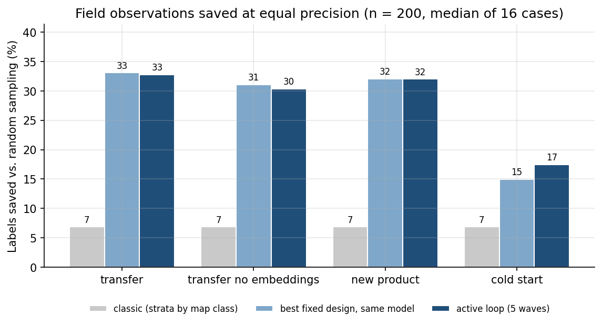
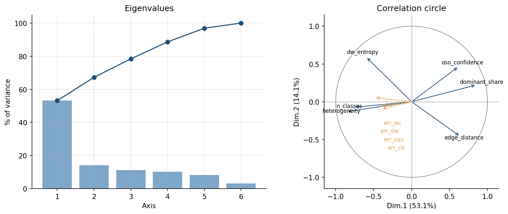

# Validating land cover maps with fewer field observations

[](https://github.com/ANTONIN2410/active-learning-map-validation/actions/workflows/tests.yml)

Validating a land cover map means checking it against field observations, and field observations are
expensive. This project asks two questions: can a model of *where the map is likely to be wrong* tell us
where to observe, and does it help to update that model wave after wave, as observations come in (an
active learning loop)? Throughout, the estimate of the map's error rate must stay unbiased, with a valid
confidence interval, whatever the quality of the model.

On 10,583 LUCAS field points and four European land cover maps:

* **An error model trained elsewhere saves about a third of the field observations** for the same
  precision. A fixed stratified design built on that model does as well as the iterative loop: the gain
  comes from the model, not from the loop.
* **With no prior data at all, the loop saves 17.5%.** This is where learning while observing pays off.
  A classical two-phase design (one random wave, one model fit, one targeted wave) already saves 15.0%:
  most of that gain comes from the first update, and iterating adds a modest 1.3 points.
* **The confidence intervals keep their nominal coverage** (93% to 96% for 95% intervals) in every
  scenario, including with a deliberately wrong model.



## Results

Median label saving at equal precision against simple random sampling (16 map × region cases, held-out
half of the data, 200 observations, exact variances; coverage over 1,000 simulated campaigns per design):

| What is known before the first observation | Active loop (5 waves) | Best fixed design, same model | Classic stratification by map class |
|---|---|---|---|
| Error model trained in other regions | 32.8% | 33.1% | 6.9% |
| Same, without satellite embeddings | 30.4% | 31.0% | 6.9% |
| A map never validated before (model trained on the other maps) | 32.0% | 32.1% | 6.9% |
| Six landscape indicators only, model trained in other regions | not run | 21.8% | 6.9% |
| Nothing (cold start) | 17.5% | 15.0% (two-phase) | 6.9% |

Across the 16 cases the loop's saving ranges from 21% to 55% with a transferred model, and from 9% to 33%
in cold start. The full table, per case and for n = 100, 200 and 500, is in
[`reports/results/benchmark.csv`](reports/results/benchmark.csv).

The "best fixed design" is stratification on the predicted error with Neyman allocation and a difference
estimator. Two readings follow. With a good transferred model, the loop matches that fixed design but does
not beat it (it does better in 5 cases out of 16): updating a model that is already good brings little.
Without prior data, the loop beats the two-phase design in 12 cases out of 16, by a median of 1.3 points
(between -1.6 and +3.0), and in 13 out of 16 at n = 100. The case for iterating is real but small; the
case for a model of where maps fail, and for estimating with it, is large.

## What the method is, and what it is not

The engine is closer to *active testing* or *active statistical inference* than to active learning in
the usual machine learning sense: the goal is not to train a classifier but to estimate one number, the
error rate of a map, with as few labels as possible. The model only decides where to look; the estimate
comes from a probability design.

```
          ┌────────────────────────────────────────────────────────────┐
          ▼                                                            │
  1. predict f = P(map wrong | x)  →  2. draw a wave (strata by f,  →  3. observe, update
     at every candidate point          Neyman allocation)               the error model
```

* **Error model**: a logistic regression on features available at every pixel without a field visit
  (disagreement between maps, landscape heterogeneity, confidence layers, and a "fifth opinion" from
  satellite embeddings). It is either transferred from other regions and recalibrated after each wave
  (maximum a posteriori, prior centred on the transferred model), or learned from scratch.
* **Sampling**: each wave is a stratified random sample fixed before its observations, so the selection
  probabilities are always known.
* **Estimation**: a stratified difference estimator per wave, averaged over waves. Each wave is unbiased
  given the past, so the waves form a martingale, which gives the variance and the confidence interval.
  A bad model costs efficiency, never validity (this is tested in `tests/test_engine.py`).

## The path, notebook by notebook

| Notebook | What it does |
|---|---|
| [`01_exploration_pca`](notebooks/01_exploration_pca.ipynb) | Error rates with confidence intervals (naive and block bootstrap), chi-square tests, normed PCA of the indicators with supplementary variables |
| [`02_logistic_regression`](notebooks/02_logistic_regression.ipynb) | Binomial GLM: likelihood-ratio tests, backward selection, odds ratios, simulated residuals (DHARMa-style), standard errors clustered by spatial block, Moran's I of the residuals; then leave-one-region-out AUC of three feature sets |
| [`03_active_learning`](notebooks/03_active_learning.ipynb) | The engine on one campaign, what it learns wave by wave, and the full benchmark |

I started with the classical statistical toolbox of my Master's course (PCA, frequentist inference,
generalised linear models) before the sampling part: the PCA showed that map errors sit on one main
gradient of landscape heterogeneity, the GLM quantified which indicators matter, and that model became
the engine's starting point. Spatial dependence between neighbouring points was checked rather than
assumed away: it widens the naive intervals on error rates by up to 40%, but leaves the GLM's conclusions
unchanged (clustered standard errors within 18% of the naive ones, no residual autocorrelation).



## Experimental design

* **Data**: LUCAS 2022 points observed in the field (surveyed in 2022 and early 2023), in four French
  study areas; ESA WorldCover, Dynamic World, Theia OSO and CLC+ Backbone (2021), harmonised to seven
  classes. Details in [`data/README.md`](data/README.md).
* **No leakage**: every 20 km spatial block goes entirely to a development half or a test half. The
  error model and the engine settings were chosen on the development half; the test half is used once,
  for the benchmark. Error models are always trained in the *other* study areas.
* **Fair baselines**: simple random sampling, stratification by map class, five fixed designs that use
  the same error model as the engine (including stratification on the predicted error with Neyman
  allocation), and, without prior data, a two-phase design.
* **Precise comparisons**: fixed designs are compared through their exact variance; for the engine, the
  exact conditional variance of each wave is averaged over simulated campaigns.
* **Pre-registered**: the engine, the comparisons, the success criteria and my numerical predictions were
  committed before the first run on the test half. All twelve criteria were met; three predictions were
  wrong. The protocol, its timeline and its results are in
  [`docs/preregistration.md`](docs/preregistration.md). The two-phase baseline was added afterwards and
  is exploratory.

## Limitations

* **Retrospective benchmark.** The candidate points are the LUCAS points themselves (1,019 to 2,036 per
  case), and samples are drawn with replacement from that pool. This is a good approximation at n = 100
  or 200; at n = 500 a real campaign would sample without replacement and the gains would differ.
* **Estimand.** The target is the unweighted error rate on field-observed LUCAS points, not the
  area-weighted accuracy of the map over the territory (Olofsson et al., 2014). Keeping only points
  visited in the field is itself a non-random subsample of the LUCAS design.
* **Reference data.** LUCAS labels from trained surveyors are taken as correct. They are compared with
  10 m pixels of 2021 maps about one year later, so part of the measured "errors" is change on the
  ground or a point that does not represent its pixel. Narrow linear features (rural roads) were removed
  for that reason.
* **Scope.** Four study areas, all in France, which favours transfer between them. Only the overall
  error rate is estimated, with a constant cost per observation.
* **Citizen observers.** The project grew out of citizen science, where observers make mistakes and do
  not reach every place at the same cost. Neither is modelled here; both are the natural next step.

## Related work

* Olofsson, P., et al. (2014). Good practices for estimating area and assessing accuracy of land change.
  *Remote Sensing of Environment*, 148, 42–57.
* Stehman, S. V., & Foody, G. M. (2019). Key issues in rigorous accuracy assessment of land cover
  products. *Remote Sensing of Environment*, 231, 111199.
* Särndal, C.-E., Swensson, B., & Wretman, J. (1992). *Model Assisted Survey Sampling*. Springer.
* Kossen, J., Farquhar, S., Gal, Y., & Rainforth, T. (2021). Active Testing: Sample-Efficient Model
  Evaluation. *ICML 2021*, PMLR 139, 5753–5763.
* Imberg, H., Jonasson, J., & Axelson-Fisk, M. (2020). Optimal Sampling in Unbiased Active Learning.
  *AISTATS 2020*, PMLR 108, 559–569.
* Zrnic, T., & Candès, E. J. (2024). Active Statistical Inference. *ICML 2024*, PMLR 235, 62993–63010.

## Repository layout

```
├── data/                  LUCAS points with the four maps and the features (+ sources)
├── docs/
│   └── preregistration.md protocol, criteria and predictions written before the test run
├── notebooks/             the three notebooks above, executed
├── reports/
│   ├── figures/
│   └── results/           benchmark.csv, error_models.csv
├── scripts/
│   └── run_benchmark.py   full benchmark (16 cases)
├── src/alval/
│   ├── data.py            loading, legend, indicators
│   ├── pca.py             normed PCA with interpretation aids
│   ├── glm.py             logistic GLM, LRT, backward selection, residual and spatial checks
│   ├── features.py        features and transferred error models
│   ├── sampling.py        fixed designs: exact variances and simulation
│   ├── engine.py          the active sampling engine
│   ├── benchmark.py       retrospective benchmark
│   └── plots.py
└── tests/
```

## Reproduce

```bash
git clone https://github.com/ANTONIN2410/active-learning-map-validation.git
cd active-learning-map-validation
pip install -r requirements.txt   # exact versions used for the results
pip install -e ".[dev]"
pytest -q
python scripts/run_benchmark.py --replicates 1000 --workers 10   # about 8 minutes on 10 cores
```

## Data and licences

See [`data/README.md`](data/README.md). LUCAS (Eurostat), ESA WorldCover and Dynamic World (CC BY 4.0),
Theia OSO (Etalab), CLC+ Backbone (Copernicus), AlphaEarth satellite embeddings (CC BY 4.0).

## About

I am Antonin Gauthé, Master's student. This project grew out of my work-study placement at CNES (French
space agency), on using citizen observations to validate Earth observation products. If you use
this work, see [`CITATION.cff`](CITATION.cff).

Code under the MIT licence.

---

### Résumé en français

Peut-on choisir où envoyer des observateurs de terrain pour valider une carte d'occupation du sol avec
moins d'observations, sans biaiser l'estimation de son taux d'erreur ? Sur 10 583 points LUCAS et quatre
cartes, un modèle d'erreur appris ailleurs économise environ un tiers des observations à précision
égale, qu'il serve à un plan stratifié fixe ou à une boucle d'apprentissage actif : le gain vient du
modèle. Sans aucune donnée préalable, la boucle économise 17,5 %, contre 15,0 % pour un plan classique
en deux phases : l'essentiel vient de la première mise à jour du modèle. Les intervalles de confiance gardent leur couverture nominale. La démarche part de l'ACP
et de l'inférence fréquentiste (en contrôlant la dépendance spatiale), puis passe par la régression
logistique avant le moteur.
